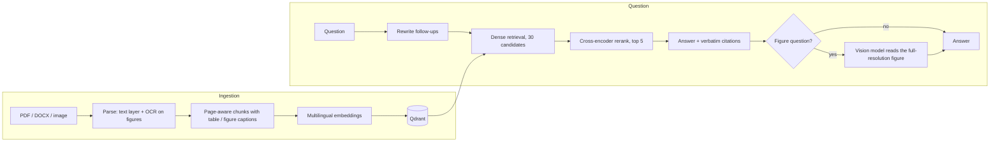

# Document RAG Assistant

Ask questions about your own documents (PDF, DOCX, images) and get answers with **verified citations**.
It reads text and figures, works across languages, and says "not found" instead of guessing.

## How it works



- **Ingestion**: PDF text layer (PyMuPDF), OCR (Tesseract) on figures and images, page-aware chunking, multilingual embeddings (e5) stored in Qdrant.
- **Retrieval**: dense search then reranking (Jina). A dense + sparse hybrid was implemented and measured; it did not help on this corpus, so dense is the default.
- **Answering**: the LLM answers only from the retrieved context and quotes it. Each quote is checked verbatim against the chunk, otherwise the answer is "not found". Follow-up questions are rewritten into standalone questions.
- **Figures**: OCR makes figures searchable; for a figure question, a vision model (Gemini) reads the full-resolution image and the text printed around it.
- **App**: FastAPI backend with SQLite history, Streamlit interface (knowledge base, discussions, highlighted source pages), light and dark mode.

## Results

Small evaluation: 2 papers, 40 questions written by the author (36 answerable, 4 not answerable), scored by an LLM judge that was validated on sanity cases. Identical runs vary by 1 to 2 questions.

| | Result |
|---|---|
| Retrieval Hit@5, dense → dense + reranker | 23/28 → 27/28 |
| Answer correctness, vision off → on | 0.80 → 0.89 |
| Figure-only questions, vision off → on | 0.31 → 0.81 |
| Unanswerable questions correctly refused | 4/4 |
| Median latency (free-tier APIs) | 13 s |

## Known limitations

- Table lookups sometimes return the value of a similar table from another section.
- Scanned PDFs still go through a local vision model that needs a GPU-class machine.
- Free-tier API quotas limit speed; there is no authentication yet.

## Run locally

1. `poetry install`, and install Tesseract with French language data.
2. Start Qdrant: `docker run -d --name qdrant -p 6333:6333 -v qdrant_data:/qdrant/storage qdrant/qdrant`
3. Copy `.env.example` to `.env` and fill in your keys.
4. API: `python -m uvicorn app.main:app --reload`
5. Interface: `python -m streamlit run ui/app.py`

## Evaluation

`python -m evaluation.collect`, then `evaluation.basic_metrics`, `evaluation.score_correctness`, `evaluation.retrieval_metrics`.


## Run with Docker

```bash
cp .env.example .env     # then fill in your keys
docker compose up -d     # Qdrant + API + interface
```

Open http://localhost:8501, add your documents in the knowledge base, and ask questions.
Data lives in Docker volumes: `docker compose down` keeps it, `docker compose down -v` deletes it.